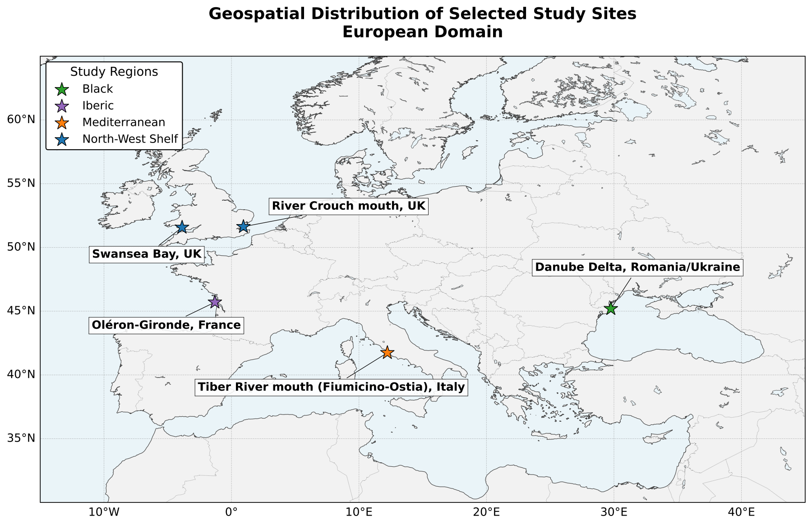
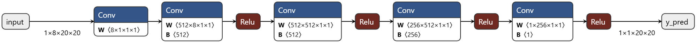
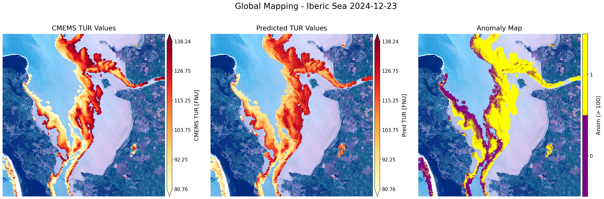

# AquaCubeAI

**AquaCubeAI-Powered Monitoring Turbidity on-board Φsat-2**

AquaCubeAI is a lightweight machine-learning framework for onboard estimation
of coastal water turbidity from simulated Φsat-2 multispectral imagery.
This repository provides training and inference code, reference models, and
tools for spatial turbidity mapping and deployment on Myriad 2.

**Authors:** Pietro Di Stasio, Francesca Razzano, Elisa Liparulo, Gabriele Meoni,
Nicolas Longépé, Deodato Tapete, Paolo Gamba, Gilda Schirinzi, and Silvia Liberata Ullo.

**Publication:** *IEEE Journal of Selected Topics in Applied Earth Observations
and Remote Sensing*, accepted 2026.

**Contact:** [p.distasio@studenti.unisannio.it](mailto:p.distasio@studenti.unisannio.it)

## Overview


*Figure 5 from the article: proposed onboard turbidity mapping workflow.*

Eight-band simulated Φsat-2 patches are paired with CMEMS HR-OC turbidity
reference targets. The regressor learns from patch-averaged spectra; its
reformulation as 1 × 1 convolutions produces dense turbidity maps. Thresholding
at TUR > 100 FNU produces the illustrative anomaly mask.

Reported agreement with CMEMS is not independent validation against direct
in situ turbidity measurements. The experiments use simulated observations;
real in-orbit validation remains a separate objective.

## Repository organization

```text
AquaCubeAI/
  notebooks/
    01_training.ipynb       # data preparation, training, evaluation, ONNX export
    02_inference.ipynb      # reference/prediction/anomaly mapping example
  aquacubeai/               # reusable data, model, training, metric and plotting code
  configs/                  # ordered source identifiers and inference example
  models/                   # selected float model, target scaling, ONNX and FP16 IR
  deployment/               # standalone OpenVINO/Myriad Python runtime
  data/README.md            # dataset access and expected layout
  docs/figures/             # Figures 1, 5, 7 and 10 from the article
```

## Getting started

Clone the repository and start from its root:

```bash
git clone https://github.com/PietroDiStasio/AquaCubeAI.git
cd AquaCubeAI
```

Use `environment.yml` for the shared scientific dependencies on Windows or Linux
x86-64, then install the PyTorch build appropriate to the computer:

```bash
conda env create -f environment.yml
conda activate aquacubeai
```

For a compatible NVIDIA GPU, retain the reference PyTorch/CUDA versions:

```bash
python -m pip install torch==2.5.1 --index-url https://download.pytorch.org/whl/cu118
```

For CPU-only execution, use this alternative instead:

```bash
python -m pip install torch==2.5.1 --index-url https://download.pytorch.org/whl/cpu
```

Register the notebook kernel and start Jupyter:

```bash
python -m ipykernel install --user --name aquacubeai --display-name "Python (AquaCubeAI)"
jupyter lab
```

These PyTorch options follow the [official installation instructions for version
2.5.1](https://pytorch.org/get-started/previous-versions/#v251). The Conda file avoids
platform-specific build identifiers; Windows and Linux receive their own compatible
GDAL/PROJ binaries. Linux requires glibc 2.28 or newer. Alternatively, install
`requirements.txt` in a Python 3.11 environment with compatible geospatial libraries.
OpenVINO/MYRIAD uses the separate runtime described in
[deployment/README.md](deployment/README.md).

Obtain the dataset from the authors and adapt the generic JSON templates to its
paths and metadata, following [configs/README.md](configs/README.md). The expected
dataset location is `AquaCubeAI/data/`; use `AQUACUBEAI_DATA_DIR` for another location
(see [data/README.md](data/README.md)). Run the notebooks in order with the
**Python (AquaCubeAI)** kernel:

1. [Training and evaluation](notebooks/01_training.ipynb): load the supplied
   sources, prepare the inputs, train, evaluate and export new models.
2. [Spatial inference](notebooks/02_inference.ipynb): use the supplied reference
   model to generate CMEMS/prediction/anomaly panels and numerical outputs.

Dataset files are **not included**. They are available upon request to
[p.distasio@studenti.unisannio.it](mailto:p.distasio@studenti.unisannio.it).
Figures and selected model artifacts are included. Generated datasets, maps and
logs are ignored by Git; the supplied notebooks have cleared execution outputs.

## Reference configuration

| Setting | Value |
| --- | --- |
| Native patch / bands | 20 × 20 / 8 |
| Training descriptor | Spatial mean per band; no additional input normalization |
| Target filter | 0 ≤ TUR < 140 FNU |
| MLP hidden layers | 512, 512, 256; batch normalization and dropout 0.25 |
| Optimization | Adam, learning rate 10⁻⁴, batch size 2,048, Huber δ = 1 |
| Target normalization | Min–max parameters fitted on training only |
| Dense ONNX input / output | `[1,8,20,20]` / `[1,1,20,20]` |

Data source paths are configured in `configs/sources_20x20.json`, or in the
corresponding file supplied with the dataset under `metadata/`. Public JSON files
use generic examples; see [configuration options](configs/README.md).

Training outputs are saved in `outputs/training/`.

## Study areas



*Figure 1 from the article: localized study areas within the European marine regions.*

## Spatial model



*Figure 7 from the article: spatial turbidity prediction using shared MLP weights.*

## Mapping example



*Figure 10 from the article: Oléron–Gironde AoI, CMEMS reference turbidity,
predicted turbidity and threshold exceedances (TUR > 100 FNU).*

## Publication

Pietro Di Stasio, Francesca Razzano, Elisa Liparulo, Gabriele Meoni,
Nicolas Longépé, Deodato Tapete, Paolo Gamba, Gilda Schirinzi, and
Silvia Liberata Ullo.

**AquaCubeAI-Powered Monitoring Turbidity on-board Φsat-2.**
*IEEE Journal of Selected Topics in Applied Earth Observations and Remote Sensing
(IEEE JSTARS)*, 2026. Accepted for publication.
